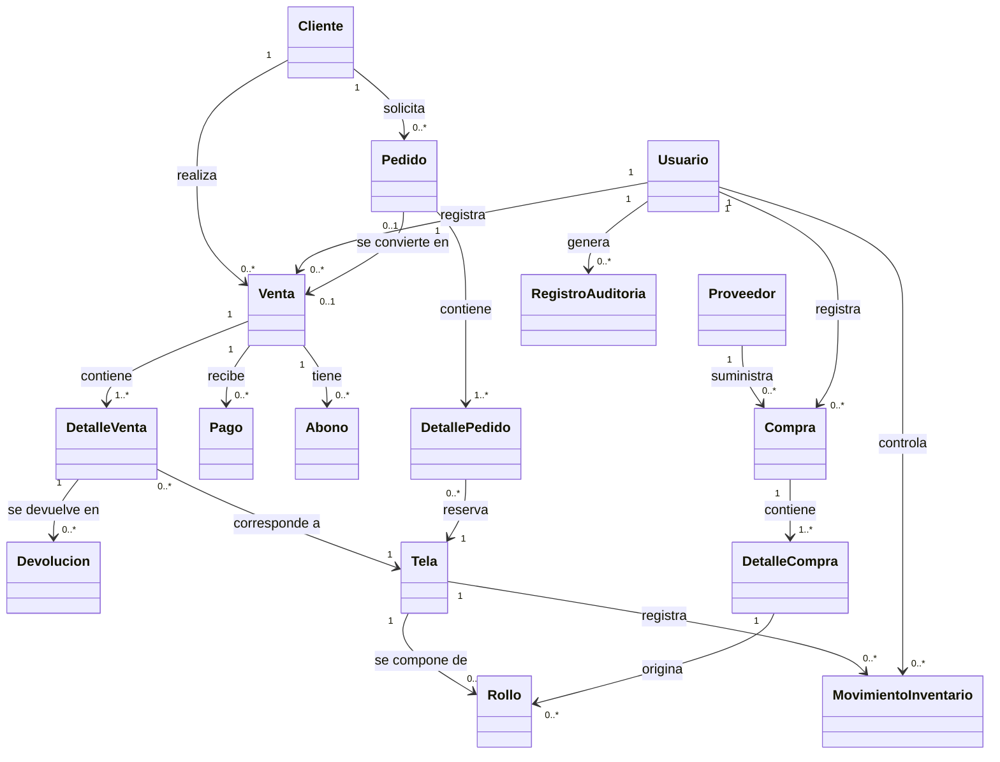

<!-- @format -->

# ProyectoFinal

# Sistema de Gestión Telas Juanita

Aplicación web para la tienda textil **Telas Juanita** (Tarija, Bolivia). Reemplaza el control manual en cuadernos y cubre inventario, ventas, pagos, crédito, pedidos y reservas, proveedores, catálogo en línea, reportes y control de acceso.

Proyecto académico de Desarrollo de Sistemas II (UPDS). Documentación basada en el SRS versión 2.0 y en el SDD (System Design Document) versión 1.1.

## Registro de cambios

- 1.0 (10/11/2026): primera versión, secciones 1 a 8.
- 1.1 (16/11/2026): se define Supabase como plataforma de datos; se ajustan arquitectura, seguridad y respaldos; se actualizan los diagramas.

## Contexto del problema

La tienda vende telas por metro, por corte o por rollo completo. Hoy todo se anota en cuadernos, lo que causa:

- Errores de existencias: se ofrecen telas agotadas o se compran de más.
- Poca claridad en los saldos de clientes con crédito (fiado).
- Reservas por WhatsApp sin registro, por lo que a veces se vende lo reservado.
- Devoluciones y correcciones sin saber quién las autorizó ni por qué.
- Cierres y reportes manuales que toman casi un día al mes.

## Objetivos

- Registrar una venta simple en menos de 2 minutos y máximo 5 pasos.
- Mantener el inventario en tiempo real.
- Proteger la integridad de ventas, pagos y saldos.
- Ofrecer un catálogo público consultable desde el celular.

## Actores

- **ACT-01 Vendedor/a:** registra clientes, ventas, pagos, devoluciones, abonos y pedidos.
- **ACT-02 Encargado de almacén:** administra telas, rollos, existencias, ajustes, proveedores y compras.
- **ACT-03 Cliente:** consulta el catálogo público, hace pedidos en línea y consulta su saldo con carnet y código.
- **ACT-04 Dueña/Administradora:** define precios, descuentos y stock mínimo, autoriza anulaciones, administra usuarios y consulta reportes y auditoría.

## Módulos y requisitos funcionales

**Clientes**

- RF-01 Gestionar clientes (registrar, actualizar y buscar por nombre, carnet o NIT).

**Inventario**

- RF-02 Registrar telas (código, nombre, tipo, color, ancho, precio por metro y foto JPG o PNG).
- RF-03 Registrar rollos con metros iniciales y fecha.
- RF-04 Consultar existencias (disponible = existencias menos reservas vigentes).
- RF-05 Alertar stock mínimo.
- RF-06 Ajustar inventario con motivo obligatorio.
- RF-07 Deshabilitar telas en lugar de borrarlas.

**Ventas**

- RF-08 Registrar venta por metro, corte o rollo completo, validando disponibilidad.
- RF-09 Calcular totales y descuentos por mayor.
- RF-10 Registrar pagos en efectivo, QR o transferencia (solo registro) y ventas a crédito con pagos parciales.
- RF-11 Generar nota de venta en PDF tamaño A4.
- RF-12 Registrar devoluciones totales o parciales y reponer metros.
- RF-13 Anular ventas con motivo y autorización de la dueña.

**Crédito y cobranza**

- RF-14 Consultar saldos.
- RF-15 Registrar abonos.
- RF-16 Emitir comprobante de abono en PDF.

**Pedidos y reservas**

- RF-17 Registrar pedidos y reservas con fecha de entrega o vencimiento.
- RF-18 Apartar metros reservados.
- RF-19 Liberar metros de reservas vencidas o canceladas (prioridad baja).

**Proveedores y compras**

- RF-20 Gestionar proveedores.
- RF-21 Registrar compras de rollos e historial de compras.

**Catálogo en línea**

- RF-22 Consultar catálogo público sin iniciar sesión.
- RF-23 Realizar pedidos en línea.
- RF-24 Consultar saldo del cliente con carnet y código (prioridad baja).

**Reportes**

- RF-25 Reportes de ventas diarios y mensuales.
- RF-26 Reporte de rotación de telas.
- RF-27 Exportar reportes a PDF.
- RF-28 Cierre de caja diario con totales por método de pago.

**Seguridad y administración**

- RF-29 Iniciar sesión con bloqueo tras 5 intentos fallidos.
- RF-30 Administrar usuarios y roles.
- RF-31 Definir precios y descuentos con historial de precios.
- RF-32 Consultar auditoría.

## Requisitos no funcionales

**Rendimiento**

- RNF-01 Búsquedas en menos de 2 s en el 95 % de los casos.
- RNF-02 Soporte de 20 usuarios simultáneos.
- RNF-03 Nota de venta en PDF en menos de 5 s.
- RNF-04 Catálogo en menos de 4 s con conexión 3G.

**Disponibilidad y confiabilidad**

- RNF-05 Disponibilidad del 99,5 % en horario de atención.
- RNF-06 Respaldo diario con retención de 30 días y restauración en máximo 4 horas.
- RNF-07 Operaciones críticas atómicas (venta, pago, anulación, abono).

**Seguridad**

- RNF-08 Contraseñas con hash seguro y mínimo 8 caracteres.
- RNF-09 Control de acceso por rol validado siempre en el servidor.
- RNF-10 HTTPS con TLS 1.2 o superior.
- RNF-11 Datos personales y respaldos cifrados.
- RNF-12 Auditoría conservada al menos 12 meses.
- RNF-13 Cierre de sesión tras 15 minutos de inactividad.
- RNF-14 Validación y limpieza de entradas contra inyección de código.

**Usabilidad**

- RNF-15 Interfaz adaptable de 360 a 1920 px sin desplazamiento horizontal.
- RNF-16 Venta simple en máximo 5 pasos y menos de 2 minutos.
- RNF-17 Interfaz y mensajes en español, con errores claros y cortos.
- RNF-18 Capacitación de máximo 1 hora.

**Mantenibilidad y escalabilidad**

- RNF-19 Módulos independientes y entrega por etapas.
- RNF-20 Crecimiento hasta 50 usuarios y 100.000 ventas.

**Compatibilidad**

- RNF-21 Dos últimas versiones de Chrome, Firefox y Edge, y Chrome y Safari móviles.

**Datos y restricciones**

- RNF-22 Metros con 2 decimales y montos en bolivianos con redondeo consistente.
- RNF-23 Base de datos relacional y de licencia libre: PostgreSQL sobre Supabase.
- RNF-24 Datos personales solo para fines de la tienda.

## Casos de uso

El diagrama está en la página "Casos de uso" de `TelasJuanita_UML_Casos_de_Uso.drawio`.

- CU-01 Iniciar sesión (RF-29)
- CU-02 Registrar y buscar clientes (RF-01)
- CU-03 Registrar venta (RF-08, RF-09); incluye CU-04 y CU-05
- CU-04 Registrar pago (RF-10)
- CU-05 Generar nota de venta en PDF (RF-11)
- CU-06 Registrar venta a crédito (RF-10, RF-14); extiende CU-03
- CU-07 Registrar abono y emitir comprobante (RF-15, RF-16)
- CU-08 Consultar saldos de clientes (RF-14)
- CU-09 Registrar devolución (RF-12)
- CU-10 Anular venta (RF-13); incluye CU-10a Autorizar anulación (RN-04)
- CU-11 Gestionar pedidos y reservas (RF-17 a RF-19)
- CU-12 Gestionar telas (RF-02, RF-07)
- CU-13 Registrar rollos y ajustar inventario (RF-03, RF-06)
- CU-14 Consultar existencias y alertas de stock (RF-04, RF-05)
- CU-15 Gestionar proveedores (RF-20)
- CU-16 Registrar compras de rollos (RF-21)
- CU-17 Consultar catálogo en línea (RF-22)
- CU-18 Realizar pedido en línea (RF-23)
- CU-19 Consultar saldo del cliente (RF-24)
- CU-20 Generar reportes (RF-25 a RF-27)
- CU-21 Realizar cierre de caja (RF-28)
- CU-22 Administrar usuarios y roles (RF-30)
- CU-23 Definir precios y descuentos (RF-31)
- CU-24 Consultar auditoría (RF-32)

## Arquitectura

Aplicación web de tres capas (presentación, aplicación y datos) con módulos independientes. El diagrama está en la página "Arquitectura" de `TelasJuanita_UML_Casos_de_Uso.drawio`.

- **Presentación:** navegador (PC o celular) con HTML5, CSS y JavaScript responsive; catálogo público sin sesión.
- **Aplicación:** servidor web HTTPS (TLS 1.2 o superior), módulos de negocio, generador de PDF y componente de seguridad. Lenguaje y framework: por confirmar.
- **Datos:** Supabase con PostgreSQL (Row Level Security activado), Supabase Storage para las fotos de telas y Supabase Auth para las cuentas del personal.
- **Operación:** tarea programada de respaldo diario con `pg_dump`, cifrado, en almacenamiento externo con retención de 30 días.
- **Salida física:** impresora A4 en el mostrador para notas y comprobantes.

Decisiones principales:

- Tres capas cliente-servidor (se descartó el monolito sin capas).
- Aplicación web responsive (se descartaron las apps nativas).
- Base de datos relacional con transacciones (se descartó NoSQL).
- Supabase como plataforma de datos (se descartó administrar PostgreSQL propio).
- Borrado lógico y auditoría de solo inserción.
- Control de acceso por roles en el servidor y con Row Level Security.

Infraestructura de referencia: servidor de aplicación en la nube con 1 a 2 vCPU, 2 GB de memoria y 20 GB de disco, y un proyecto de Supabase en la región más cercana a Bolivia.

## Seguridad

- Contraseñas con hash y sal individual en Supabase Auth.
- Bloqueo tras 5 intentos fallidos y cierre de sesión a los 15 minutos.
- Roles validados en el servidor y con Row Level Security; solo la dueña cambia precios y autoriza anulaciones.
- HTTPS (puerto 443) y datos sensibles cifrados.
- La clave de servicio de Supabase solo vive en el servidor (variables de entorno).
- Auditoría de solo inserción con usuario, fecha y hora, conservada 12 meses.
- Validación de entradas y consultas parametrizadas.

## Límites del plan gratuito de Supabase

- Base de datos de 500 MB y archivos de 1 GB.
- No incluye respaldos propios, por eso se hace un respaldo diario aparte.
- El proyecto se pausa tras una semana sin actividad.

## Modelo de clases

El diagrama está en `diagrama_de_clases_.drawio`.

Clases y atributos:

- **Usuario:** idUsuario (UUID), nombre, correo, rol, estado, intentosFallidos.
- **Cliente:** idCliente, nombre, carnet, telefono, direccion.
- **Tela:** idTela, codigo, nombre, tipo, color, precioMetro, stockMinimo, urlFoto, estado.
- **Rollo:** idRollo, metrosIniciales, metrosDisponibles, fechaIngreso.
- **MovimientoInventario:** idMovimiento, fecha, tipo, cantidadMetros, motivo.
- **Venta:** idVenta, fecha, total, descuento, estado, esCredito, saldoPendiente, motivoAnulacion.
- **DetalleVenta:** idDetalleVenta, cantidadMetros, precioUnitario, subtotal.
- **Pago:** idPago, fecha, monto, metodoPago.
- **Abono:** idAbono, fecha, monto.
- **Devolucion:** idDevolucion, fecha, cantidadMetros, monto, motivo.
- **Pedido:** idPedido, tipo, fecha, fechaVencimiento, estado.
- **DetallePedido:** idDetallePedido, cantidadMetros, subtotal.
- **Proveedor:** idProveedor, nombre, telefono, nit.
- **Compra:** idCompra, fecha, total.
- **DetalleCompra:** idDetalleCompra, cantidadMetros, costoUnitario.
- **RegistroAuditoria:** idRegistro, fechaHora, accion, entidad.

## Glosario

- **Rollo:** pieza completa de tela enrollada, tal como la entrega el proveedor.
- **Corte:** cantidad exacta de tela, en metros, que el cliente pide y se separa del rollo.
- **Stock mínimo:** metros por debajo de los cuales el sistema avisa que hay que reponer.
- **Cuenta por cobrar:** saldo que un cliente debe por una venta a crédito.
- **Abono:** pago parcial sobre un saldo pendiente.
- **Nota de venta:** comprobante interno; no reemplaza a la factura oficial.
- **Reserva:** tela apartada para un cliente que aún no la compró.

## Alcance y restricciones

- El sistema es independiente: el pago por QR o transferencia solo se registra y la facturación oficial queda fuera.
- Se emiten notas de venta, no facturas.
- Ventas, pagos y anulaciones no se borran, solo se anulan (RN-10).
- Supuestos: internet estable, una computadora e impresora A4 en el mostrador, hasta 20 usuarios simultáneos y carga inicial única de telas.

## Archivos del proyecto

- `Sistema_Gestion_TelasJuanita` — documento SDD (versión 1.1).
- `TelasJuanita_UML_Casos_de_Uso.drawio` — casos de uso y arquitectura.
- `diagrama_de_clases_.drawio` — diagrama de clases.

## Equipo

- Por completar (nombres de los integrantes y docente).
