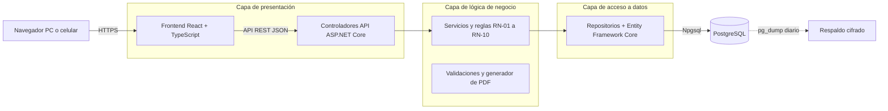
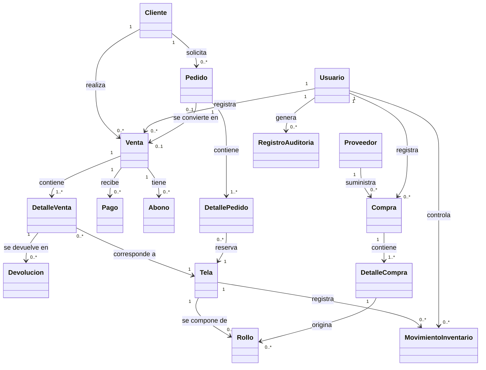

<!-- @format -->

# Sistema de Gestión Telas Juanita

Aplicación web para la tienda textil **Telas Juanita** (Tarija, Bolivia). Reemplaza el control manual en cuadernos y cubre inventario, ventas, pagos, crédito, pedidos y reservas, proveedores, catálogo en línea, reportes y control de acceso.

Proyecto académico de Desarrollo de Sistemas II (UPDS). Documentación basada en el SRS versión 2.0 y en el SDD versión 1.1, actualizada a la **versión 1.2** con las tecnologías y la arquitectura en capas exigidas por el docente: **TypeScript, .NET (C#) y PostgreSQL**.

## Registro de cambios

- 1.0 (10/11/2026): primera versión, secciones 1 a 8.
- 1.1 (16/11/2026): se define Supabase como plataforma de datos; se ajustan arquitectura, seguridad y respaldos; se actualizan los diagramas.
- 1.2 (18/11/2026): se define el stack TypeScript + .NET (C#) con PostgreSQL local administrado con DBeaver (reemplaza a Supabase); se define la arquitectura en tres capas; se agregan la estructura del repositorio, la guía de instalación, la metodología de trabajo y el cronograma de 10 días.

## Contexto del problema

La tienda vende telas por metro, por corte o por rollo completo. Hoy todo se anota en cuadernos, lo que causa:

- Errores de existencias: se ofrecen telas agotadas o se compran de más.
- Poca claridad en los saldos de clientes con crédito (fiado).
- Reservas por WhatsApp sin registro, por lo que a veces se vende lo reservado.
- Devoluciones y correcciones sin saber quién las autorizó ni por qué.
- Cierres y reportes manuales que toman casi un día al mes.

## Objetivos

- Registrar una venta simple en menos de 2 minutos y máximo 5 pasos.
- Mantener el inventario en tiempo real.
- Proteger la integridad de ventas, pagos y saldos.
- Ofrecer un catálogo público consultable desde el celular.

## Actores

- **ACT-01 Vendedor/a:** registra clientes, ventas, pagos, devoluciones, abonos y pedidos.
- **ACT-02 Encargado de almacén:** administra telas, rollos, existencias, ajustes, proveedores y compras.
- **ACT-03 Cliente:** consulta el catálogo público, hace pedidos en línea y consulta su saldo con carnet y código.
- **ACT-04 Dueña/Administradora:** define precios, descuentos y stock mínimo, autoriza anulaciones, administra usuarios y consulta reportes y auditoría.

## Módulos y requisitos funcionales

**Clientes**

- RF-01 Gestionar clientes (registrar, actualizar y buscar por nombre, carnet o NIT).

**Inventario**

- RF-02 Registrar telas (código, nombre, tipo, color, ancho, precio por metro y foto JPG o PNG).
- RF-03 Registrar rollos con metros iniciales y fecha.
- RF-04 Consultar existencias (disponible = existencias menos reservas vigentes).
- RF-05 Alertar stock mínimo.
- RF-06 Ajustar inventario con motivo obligatorio.
- RF-07 Deshabilitar telas en lugar de borrarlas.

**Ventas**

- RF-08 Registrar venta por metro, corte o rollo completo, validando disponibilidad.
- RF-09 Calcular totales y descuentos por mayor.
- RF-10 Registrar pagos en efectivo, QR o transferencia (solo registro) y ventas a crédito con pagos parciales.
- RF-11 Generar nota de venta en PDF tamaño A4.
- RF-12 Registrar devoluciones totales o parciales y reponer metros.
- RF-13 Anular ventas con motivo y autorización de la dueña.

**Crédito y cobranza**

- RF-14 Consultar saldos.
- RF-15 Registrar abonos.
- RF-16 Emitir comprobante de abono en PDF.

**Pedidos y reservas**

- RF-17 Registrar pedidos y reservas con fecha de entrega o vencimiento.
- RF-18 Apartar metros reservados.
- RF-19 Liberar metros de reservas vencidas o canceladas (prioridad baja).

**Proveedores y compras**

- RF-20 Gestionar proveedores.
- RF-21 Registrar compras de rollos e historial de compras.

**Catálogo en línea**

- RF-22 Consultar catálogo público sin iniciar sesión.
- RF-23 Realizar pedidos en línea.
- RF-24 Consultar saldo del cliente con carnet y código (prioridad baja).

**Reportes**

- RF-25 Reportes de ventas diarios y mensuales.
- RF-26 Reporte de rotación de telas.
- RF-27 Exportar reportes a PDF.
- RF-28 Cierre de caja diario con totales por método de pago.

**Seguridad y administración**

- RF-29 Iniciar sesión con bloqueo tras 5 intentos fallidos.
- RF-30 Administrar usuarios y roles.
- RF-31 Definir precios y descuentos con historial de precios.
- RF-32 Consultar auditoría.

## Requisitos no funcionales

**Rendimiento**

- RNF-01 Búsquedas en menos de 2 s en el 95 % de los casos.
- RNF-02 Soporte de 20 usuarios simultáneos.
- RNF-03 Nota de venta en PDF en menos de 5 s.
- RNF-04 Catálogo en menos de 4 s con conexión 3G.

**Disponibilidad y confiabilidad**

- RNF-05 Disponibilidad del 99,5 % en horario de atención.
- RNF-06 Respaldo diario con retención de 30 días y restauración en máximo 4 horas.
- RNF-07 Operaciones críticas atómicas (venta, pago, anulación, abono).

**Seguridad**

- RNF-08 Contraseñas con hash seguro y mínimo 8 caracteres.
- RNF-09 Control de acceso por rol validado siempre en el servidor.
- RNF-10 HTTPS con TLS 1.2 o superior.
- RNF-11 Datos personales y respaldos cifrados.
- RNF-12 Auditoría conservada al menos 12 meses.
- RNF-13 Cierre de sesión tras 15 minutos de inactividad.
- RNF-14 Validación y limpieza de entradas contra inyección de código.

**Usabilidad**

- RNF-15 Interfaz adaptable de 360 a 1920 px sin desplazamiento horizontal.
- RNF-16 Venta simple en máximo 5 pasos y menos de 2 minutos.
- RNF-17 Interfaz y mensajes en español, con errores claros y cortos.
- RNF-18 Capacitación de máximo 1 hora.

**Mantenibilidad y escalabilidad**

- RNF-19 Módulos independientes y entrega por etapas.
- RNF-20 Crecimiento hasta 50 usuarios y 100.000 ventas.

**Compatibilidad**

- RNF-21 Dos últimas versiones de Chrome, Firefox y Edge, y Chrome y Safari móviles.

**Datos y restricciones**

- RNF-22 Metros con 2 decimales y montos en bolivianos con redondeo consistente.
- RNF-23 Base de datos relacional y de licencia libre: PostgreSQL, administrada con DBeaver.
- RNF-24 Datos personales solo para fines de la tienda.

## Casos de uso

El diagrama está en la página "Casos de uso" de `TelasJuanita_UML_Casos_de_Uso.drawio`.

- CU-01 Iniciar sesión (RF-29)
- CU-02 Registrar y buscar clientes (RF-01)
- CU-03 Registrar venta (RF-08, RF-09); incluye CU-04 y CU-05
- CU-04 Registrar pago (RF-10)
- CU-05 Generar nota de venta en PDF (RF-11)
- CU-06 Registrar venta a crédito (RF-10, RF-14); extiende CU-03
- CU-07 Registrar abono y emitir comprobante (RF-15, RF-16)
- CU-08 Consultar saldos de clientes (RF-14)
- CU-09 Registrar devolución (RF-12)
- CU-10 Anular venta (RF-13); incluye CU-10a Autorizar anulación (RN-04)
- CU-11 Gestionar pedidos y reservas (RF-17 a RF-19)
- CU-12 Gestionar telas (RF-02, RF-07)
- CU-13 Registrar rollos y ajustar inventario (RF-03, RF-06)
- CU-14 Consultar existencias y alertas de stock (RF-04, RF-05)
- CU-15 Gestionar proveedores (RF-20)
- CU-16 Registrar compras de rollos (RF-21)
- CU-17 Consultar catálogo en línea (RF-22)
- CU-18 Realizar pedido en línea (RF-23)
- CU-19 Consultar saldo del cliente (RF-24)
- CU-20 Generar reportes (RF-25 a RF-27)
- CU-21 Realizar cierre de caja (RF-28)
- CU-22 Administrar usuarios y roles (RF-30)
- CU-23 Definir precios y descuentos (RF-31)
- CU-24 Consultar auditoría (RF-32)

## Tecnologías

**Obligatorias (indicadas por el docente)**

- **TypeScript** para el frontend.
- **.NET con C#** para el backend.
- **PostgreSQL** como base de datos, administrada con **DBeaver**.
- Desarrollo **en capas**: presentación, lógica de negocio y acceso a datos (ver la sección de arquitectura).

**Stack elegido por el equipo**

- Frontend: React con TypeScript, creado con Vite; React Router para las pantallas; Tailwind CSS para el diseño adaptable (360 a 1920 px); Zod para validar formularios.
- Backend: ASP.NET Core Web API (C#), con controladores.
- Acceso a datos: Entity Framework Core con el proveedor Npgsql; migraciones para crear las tablas; consultas parametrizadas (RNF-14).
- Autenticación: JWT con contraseñas cifradas con BCrypt (paquete BCrypt.Net-Next).
- Validación en el servidor: FluentValidation.
- PDF (notas de venta, comprobantes y reportes): QuestPDF con licencia Community.
- Pruebas: xUnit en el backend y Vitest en el frontend.
- Respaldo: `pg_dump` programado (tareas programadas de Windows o cron).
- Control de versiones y tablero: Git y GitHub (GitHub Projects).
- Modelado: draw.io (UML).

Las versiones exactas de .NET y Node.js deben ser las mismas en los tres equipos (usar la versión LTS vigente y anotarla en este README el día 1).

## Arquitectura en capas

Aplicación web cliente-servidor dividida en tres capas, cada una con una responsabilidad única. El diagrama UML de arquitectura está en la página "Arquitectura" de `TelasJuanita_UML_Casos_de_Uso.drawio` y debe actualizarse con este stack (PostgreSQL local en lugar de Supabase).



**1. Capa de presentación**

- Frontend en React + TypeScript: pantallas del personal y catálogo público (sin sesión).
- Controladores de ASP.NET Core: reciben la petición HTTP, validan el formato, llaman a un servicio de negocio y devuelven JSON. No contienen reglas de negocio ni consultas.

**2. Capa de lógica de negocio**

- Servicios C# por módulo (clientes, inventario, ventas, crédito, pedidos, proveedores, reportes, seguridad).
- Aquí viven las reglas del negocio: disponibilidad = existencias menos reservas vigentes, descuentos por mayor, venta atómica, anulaciones con autorización, bloqueo tras 5 intentos.
- Genera los PDF y escribe la auditoría.
- Usa DTOs para recibir y devolver datos; no expone las entidades de la base directamente.

**3. Capa de acceso a datos**

- Entidades, `DbContext` de Entity Framework Core y repositorios.
- Es la única capa que se conecta a PostgreSQL. No contiene reglas de negocio.

**Reglas de dependencia**

- La presentación solo conoce la lógica de negocio; nunca llama a la capa de datos.
- La lógica de negocio solo conoce las interfaces de los repositorios.
- La capa de datos no conoce a las otras dos.
- Los módulos se comunican entre sí por sus servicios, no por las tablas de otro módulo.
- Las operaciones críticas (venta, pago, anulación, abono) se ejecutan en una transacción (RNF-07).

**Módulos:** Clientes, Inventario, Ventas, Crédito y cobranza, Pedidos y reservas, Proveedores y compras, Catálogo en línea, Reportes, Seguridad y administración. Cada módulo tiene su controlador, su servicio y su repositorio.

**Infraestructura de referencia**

- Desarrollo: los tres integrantes trabajan en local (API, frontend y PostgreSQL en la laptop).
- Producción: un servidor o equipo de la tienda con el backend (Kestrel detrás de un servidor web con HTTPS), los archivos estáticos del frontend y PostgreSQL; impresora A4 en el mostrador.

## Estructura del repositorio

```
TelasJuanita/
├── README.md
├── docs/                         SDD, SRS y archivos .drawio
├── database/
│   ├── 01_esquema.sql            tablas (exportado al final desde DBeaver)
│   ├── 02_datos_iniciales.sql    roles, usuario dueña y datos de prueba
│   └── respaldos/                copias pg_dump (no se suben a Git)
├── backend/
│   ├── TelasJuanita.sln
│   ├── TelasJuanita.Api/         capa de presentación: controladores, Program.cs
│   ├── TelasJuanita.Business/    capa de lógica de negocio: servicios, DTOs, validadores, PDF
│   ├── TelasJuanita.Data/        capa de acceso a datos: entidades, DbContext, repositorios, migraciones
│   └── TelasJuanita.Tests/       pruebas xUnit
└── frontend/                     React + TypeScript (Vite)
    └── src/
        ├── pages/                una carpeta por módulo
        ├── components/
        ├── services/             llamadas a la API
        ├── types/
        └── hooks/
```

**Convenciones**

- Nombres de tablas, clases y variables en un solo idioma (español, como el diagrama de clases).
- Metros con 2 decimales y montos en bolivianos con tipo `decimal` / `numeric` (RNF-22).
- La cadena de conexión y la clave del JWT no se suben a Git: se guardan con `dotnet user-secrets` o en variables de entorno. El archivo `.gitignore` debe excluir `appsettings.Development.json`, `node_modules/`, `bin/`, `obj/` y `database/respaldos/`.

## Seguridad

- Contraseñas con hash BCrypt y mínimo 8 caracteres (RNF-08).
- Autenticación con JWT; la sesión se cierra a los 15 minutos de inactividad (RNF-13).
- Bloqueo de la cuenta tras 5 intentos fallidos (campos `intentosFallidos` y `estado` de Usuario).
- Roles (vendedor, encargado de almacén, dueña) validados siempre en el backend con autorización por rol (RNF-09); el frontend solo oculta pantallas.
- Solo la dueña cambia precios y autoriza anulaciones (RN-04).
- HTTPS con TLS 1.2 o superior (RNF-10) y CORS limitado al origen del frontend.
- Cadena de conexión y clave del JWT fuera del repositorio.
- Auditoría de solo inserción con usuario, fecha y hora, conservada 12 meses (RNF-12): el usuario de base de datos de la aplicación solo tiene permisos `INSERT` y `SELECT` sobre esa tabla.
- Validación de entradas en pantalla (Zod) y en el servidor (FluentValidation); consultas parametrizadas con Entity Framework Core (RNF-14).
- Datos personales de clientes: respaldos cifrados (RNF-11) y, si el tiempo alcanza, cifrado de columnas con `pgcrypto`.
- Ventas, pagos y anulaciones no se borran (borrado lógico, RN-10).

## Modelo de clases

El diagrama está en `diagrama_de_clases_.drawio`.



Clases y atributos:

- **Usuario:** idUsuario (UUID), nombre, correo, rol, estado, intentosFallidos.
- **Cliente:** idCliente, nombre, carnet, telefono, direccion.
- **Tela:** idTela, codigo, nombre, tipo, color, precioMetro, stockMinimo, urlFoto, estado.
- **Rollo:** idRollo, metrosIniciales, metrosDisponibles, fechaIngreso.
- **MovimientoInventario:** idMovimiento, fecha, tipo, cantidadMetros, motivo.
- **Venta:** idVenta, fecha, total, descuento, estado, esCredito, saldoPendiente, motivoAnulacion.
- **DetalleVenta:** idDetalleVenta, cantidadMetros, precioUnitario, subtotal.
- **Pago:** idPago, fecha, monto, metodoPago.
- **Abono:** idAbono, fecha, monto.
- **Devolucion:** idDevolucion, fecha, cantidadMetros, monto, motivo.
- **Pedido:** idPedido, tipo, fecha, fechaVencimiento, estado.
- **DetallePedido:** idDetallePedido, cantidadMetros, subtotal.
- **Proveedor:** idProveedor, nombre, telefono, nit.
- **Compra:** idCompra, fecha, total.
- **DetalleCompra:** idDetalleCompra, cantidadMetros, costoUnitario.
- **RegistroAuditoria:** idRegistro, fechaHora, accion, entidad.

## Ajustes al modelo de datos

El diagrama de clases no incluye varios datos que exigen los requisitos. Se agregan al crear las tablas el día 1:

- Ancho de la tela (RF-02).
- NIT del cliente (RF-01).
- Cierre de caja diario con totales por método de pago (RF-28).
- Historial de precios con valor anterior y fecha (RF-31).
- Descuentos por mayor definidos por la dueña (RF-09).
- Cuenta por cobrar de las ventas a crédito (RF-14).
- Rol del usuario como entidad o catálogo (vendedor, encargado de almacén, dueña).

## Base de datos

- Motor: PostgreSQL instalado en cada laptop (sin máquinas virtuales). Herramienta de administración: DBeaver.
- Base de datos: `telasjuanita`. Usuario de la aplicación: `telas_app`, con permisos mínimos (no es superusuario).
- Las tablas se crean con migraciones de Entity Framework Core a partir de las entidades y se exportan a `database/01_esquema.sql` desde DBeaver para la entrega.
- Los datos de prueba van en `database/02_datos_iniciales.sql`, con usuarios y datos ficticios (sin datos personales reales).
- Fotos de telas (JPG o PNG): se guardan en una carpeta del servidor y la tabla Tela guarda la ruta (`urlFoto`).
- Respaldo: `pg_dump` diario con tarea programada, copia cifrada en almacenamiento externo, retención de 30 días y limpieza de copias más antiguas (RNF-06).

Crear la base y el usuario (en DBeaver o `psql`, con el usuario `postgres`):

```sql
CREATE DATABASE telasjuanita;
CREATE USER telas_app WITH PASSWORD 'cambiar_esta_clave';
GRANT ALL PRIVILEGES ON DATABASE telasjuanita TO telas_app;
```

(Después de conectarse a `telasjuanita`, ejecutar también `GRANT ALL ON SCHEMA public TO telas_app;`)

## Requisitos previos (qué instalar)

Cada integrante debe tener instalado lo siguiente. Los comandos de verificación se ejecutan en PowerShell o en la terminal de VS Code.

- **Git**: `git --version`
- **Cuenta de GitHub** con acceso al repositorio del equipo.
- **.NET SDK** (versión LTS acordada por el equipo): `dotnet --version` y `dotnet --list-sdks`
- **Herramienta de Entity Framework**: `dotnet tool install --global dotnet-ef` y verificar con `dotnet ef --version`
- **Node.js LTS** (incluye npm): `node --version` y `npm --version`
- **PostgreSQL**: `psql --version` (si no se reconoce, revisar que el servicio exista con `Get-Service postgresql*` o agregar la carpeta `bin` de PostgreSQL al PATH)
- **DBeaver**: abrir el programa y crear una conexión a `localhost:5432` (usuario `postgres`); si conecta, funciona.
- **Visual Studio Code** con las extensiones C# Dev Kit, ESLint, Prettier y Tailwind CSS IntelliSense: `code --version`
- Opcional: Visual Studio 2022 Community si prefieren ese editor para el backend.

Prueba rápida de la base de datos:

```
psql -U postgres -h localhost -c "select version();"
```

Si muestra la versión de PostgreSQL, está funcionando.

## Primeros pasos (día 1)

Desde la carpeta del repositorio clonado:

```
mkdir backend
cd backend
dotnet new sln -n TelasJuanita
dotnet new webapi --use-controllers -n TelasJuanita.Api
dotnet new classlib -n TelasJuanita.Business
dotnet new classlib -n TelasJuanita.Data
dotnet new xunit -n TelasJuanita.Tests
dotnet sln add TelasJuanita.Api TelasJuanita.Business TelasJuanita.Data TelasJuanita.Tests
dotnet add TelasJuanita.Api reference TelasJuanita.Business
dotnet add TelasJuanita.Business reference TelasJuanita.Data
dotnet add TelasJuanita.Tests reference TelasJuanita.Business
dotnet add TelasJuanita.Data package Microsoft.EntityFrameworkCore
dotnet add TelasJuanita.Data package Npgsql.EntityFrameworkCore.PostgreSQL
dotnet add TelasJuanita.Api package Microsoft.EntityFrameworkCore.Design
cd ..
npm create vite@latest frontend -- --template react-ts
cd frontend
npm install
```

Ejecutar el proyecto:

```
dotnet run --project backend/TelasJuanita.Api
cd frontend
npm run dev
```

Resultado esperado del día 1: la API corre y responde una ruta de prueba que lee la base de datos, y el frontend vacío se abre en el navegador.

## Metodología de trabajo

Se mantiene el enfoque del SDD (sección 3.2): análisis y diseño orientado a objetos con UML y desarrollo **iterativo e incremental por módulos**. Para un equipo de tres personas y diez días se usa **Scrumban**: la estructura corta de Scrum (un sprint de 10 días con reunión diaria, revisión y retrospectiva) y el tablero Kanban para controlar el trabajo. Se eligió porque el alcance ya está definido en requisitos (RF), el equipo es pequeño y el plazo es corto, así que se evitan ceremonias pesadas.

**Cómo se trabaja**

- **Tablero Kanban** en GitHub Projects con las columnas Por hacer, En curso, En revisión y Hecho; una tarjeta por requisito RF.
- **Reunión diaria de 15 minutos:** qué hice, qué haré y qué me bloquea.
- **Cierre del día (10 minutos):** se actualiza el tablero y se anota lo pendiente.
- **Retrospectiva corta los días 5 y 10:** qué funcionó y qué cambiar.
- **Revisión cruzada:** nadie aprueba su propio código; cada módulo lo revisa otro integrante antes de integrarlo.
- **Trabajo en pareja** en lo más delicado (la venta atómica, días 5 y 6), mientras el tercer integrante avanza en paralelo.
- **Notas compartidas** con decisiones, errores resueltos y comandos útiles.

**Definición de "hecho"**

Un requisito está terminado cuando funciona, cumple sus RNF aplicables, respeta la separación en capas, tiene una prueba básica, fue revisado por otro integrante y la documentación queda actualizada.

**Reparto por módulos** (cada integrante desarrolla sus módulos completos, desde la pantalla hasta la base de datos, y los otros dos revisan)

- **Integrante A: datos y seguridad.** Base de datos, roles, autenticación, auditoría, respaldo y despliegue (días 1, 2 y 10). Revisa ventas y crédito.
- **Integrante B: negocio de mostrador.** Clientes, ventas, pagos, devoluciones, crédito y caja (días 3, 5, 6 y 7). Revisa inventario.
- **Integrante C: inventario y cara pública.** Telas, rollos, pedidos, proveedores, compras, catálogo y reportes (días 4, 8 y 9). Revisa seguridad.

El día 10 los tres participan en pruebas y entrega. Quien termine antes toma tareas del módulo más atrasado.

**Control de versiones**

- Ramas: `main` (estable), `develop` (integración) y una rama por tarea con el formato `feature/nombre-RFxx`.
- Cada módulo termina con una solicitud de integración (pull request) a `develop`, revisada por otro integrante.
- Mensajes de commit con el código del requisito, por ejemplo: `RF-08: registrar venta por metro`.
- `main` solo se actualiza el día 10, con el sistema probado.

## Cronograma de implementación (10 días)

Los días son hábiles de trabajo del equipo; las fechas se asignan al iniciar el día 1. El orden respeta el SDD: primero inventario, ventas y seguridad, y al final lo de prioridad baja.

**Día 1: base del proyecto** (RNF-19, RNF-22)

- Acordar y anotar las versiones de .NET y Node.js; bloque de estudio (cada integrante estudia una pieza y la explica en 10 minutos).
- Crear el repositorio, las ramas, el tablero y la solución con sus tres capas (ver Primeros pasos).
- Crear la base `telasjuanita` y las tablas desde el diagrama de clases con los ajustes al modelo.
- Resultado: API corriendo y leyendo la base; frontend vacío corriendo.

**Día 2: seguridad** (RF-29, RF-30, RNF-08, RNF-09, RNF-13)

- Inicio de sesión con JWT y BCrypt; roles; bloqueo tras 5 intentos; cierre de sesión a los 15 minutos; autorización por rol en el backend; auditoría de solo inserción.
- Resultado: los tres roles entran y cada uno ve solo lo suyo.

**Día 3: clientes y telas** (RF-01, RF-02, RF-07)

- Registro y búsqueda de clientes por nombre, carnet o NIT; registro de telas con foto JPG o PNG; deshabilitar en vez de borrar.
- Resultado: cliente y tela creados, buscados y deshabilitados.

**Día 4: inventario** (RF-03, RF-04, RF-05, RF-06)

- Ingreso de rollos; existencias (existencias menos reservas); alerta de stock mínimo; ajuste con motivo obligatorio.
- Resultado: una tela muestra sus metros disponibles y alerta al bajar del mínimo.

**Día 5: ventas, núcleo** (RF-08, RF-09, RNF-07, RNF-16)

- Venta por metro, corte o rollo completo; validación de disponibilidad; subtotales, descuentos por mayor y total; operación atómica que descuenta metros.
- Resultado: venta simple completada en máximo 5 pasos. Retrospectiva corta.

**Día 6: pagos y correcciones de venta** (RF-10, RF-11, RF-12, RF-13)

- Pagos en efectivo, QR o transferencia (solo registro) y pagos parciales; nota de venta en PDF A4; devolución total o parcial; anulación con motivo y autorización de la dueña, sin borrar la venta.
- Resultado: nota impresa; devolución y anulación reflejadas en el inventario.

**Día 7: crédito y caja** (RF-14, RF-15, RF-16, RF-28)

- Venta a crédito con cuenta por cobrar; saldos; abonos y comprobante en PDF; cierre de caja diario.
- Resultado: el saldo de un cliente baja con un abono y el cierre cuadra.

**Día 8: pedidos, proveedores y compras** (RF-17, RF-18, RF-20, RF-21)

- Pedidos y reservas que apartan metros; proveedores; compra de rollos que ingresa al inventario y guarda historial.
- Resultado: una reserva aparta metros y una compra los suma.

**Día 9: catálogo, reportes y precios** (RF-22, RF-23, RF-25, RF-26, RF-27, RF-31, RF-32)

- Catálogo público sin sesión y pedido en línea; reportes diarios, mensuales y de rotación con exportación a PDF; cambio de precios con historial; pantalla de auditoría.
- Resultado: catálogo visible desde el celular y reportes exportados.

**Día 10: pruebas, respaldo y entrega** (RNF-01 a RNF-07, RNF-15, RNF-18, RNF-21)

- Pruebas de los flujos críticos; tarea de respaldo diario con `pg_dump`, limpieza a 30 días y prueba de restauración; revisión de rendimiento (búsquedas en menos de 2 s, PDF en menos de 5 s); despliegue; guía de uso para la capacitación de 1 hora; actualización final de esta documentación; integración a `main`.
- Resultado: sistema probado, respaldado y entregado. Retrospectiva final.

**Hitos**

- Fin del día 2: acceso seguro por roles.
- Fin del día 4: inventario completo.
- Fin del día 7: ciclo comercial completo (venta, pago, crédito, caja).
- Fin del día 9: todos los módulos de prioridad alta construidos.
- Día 10: sistema probado, respaldado y entregado.

**Riesgos y qué recortar primero**

- Los días 5 y 6 son los más cargados; si se retrasan, el módulo de proveedores y compras (día 8) pasa a trabajo futuro.
- Si falta tiempo, primero se recorta el pedido en línea (RF-23) y luego el reporte de rotación (RF-26). RF-19 (liberar metros) y RF-24 (saldo del cliente) son prioridad baja y quedan como trabajo futuro.
- No se recorta seguridad, auditoría ni la atomicidad de ventas, pagos y abonos.
- Una sola base en la laptop de cada uno puede dar datos distintos: el esquema se comparte con migraciones y el script `01_esquema.sql`, y los datos de prueba con `02_datos_iniciales.sql`.
- Conviene actualizar este README al terminar cada módulo (cinco minutos por día).

## Glosario

- **Rollo:** pieza completa de tela enrollada, tal como la entrega el proveedor.
- **Corte:** cantidad exacta de tela, en metros, que el cliente pide y se separa del rollo.
- **Stock mínimo:** metros por debajo de los cuales el sistema avisa que hay que reponer.
- **Cuenta por cobrar:** saldo que un cliente debe por una venta a crédito.
- **Abono:** pago parcial sobre un saldo pendiente.
- **Nota de venta:** comprobante interno; no reemplaza a la factura oficial.
- **Reserva:** tela apartada para un cliente que aún no la compró.

## Alcance y restricciones

- El sistema es independiente: el pago por QR o transferencia solo se registra y la facturación oficial queda fuera.
- Se emiten notas de venta, no facturas.
- Ventas, pagos y anulaciones no se borran, solo se anulan (RN-10).
- Supuestos: internet estable, una computadora e impresora A4 en el mostrador, hasta 20 usuarios simultáneos y carga inicial única de telas.

## Archivos del proyecto

- `Sistema_Gestion_TelasJuanita` — documento SDD (versión 1.1).
- `TelasJuanita_UML_Casos_de_Uso.drawio` — casos de uso y arquitectura (pendiente actualizar la arquitectura al stack actual).
- `diagrama_de_clases_.drawio` — diagrama de clases.
- `Cronograma de implementación` — borrador inicial del cronograma, reemplazado por la sección de este README.

## Equipo

- Consuelo Angelica Rojas
- Ivar Tarifa
- Adrian Garcia
